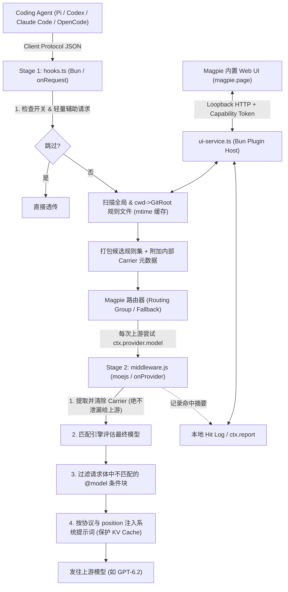

# Magpie 插件架构设计：`magpie-prompt-match`

按模型动态加载与裁剪 `AGENTS.md` 提示词的 Magpie 插件（解决如 GPT-6.2 过度防御性编程等模型特性纠偏问题）。

---

## 1. 需求共识总结

通过架构访谈，以下核心设计决策已全部对齐：

| 维度 | 最终方案 |
| :--- | :--- |
| **提示词来源** | **混合模式**：全局 `~/.config/magpie/prompts/*.md` + 项目内 `AGENTS.md` 条件块 + 项目同级 `AGENTS.<model>.md` + `.agents/prompts/*.md` |
| **与 Agent 原生 `AGENTS.md` 协同** | **智能协同（过滤 + 注入）**：自动剥离请求体中不匹配当前模型的条件块、避免重复注入已保留块，并将外部/全局规则注入系统提示词 |
| **模型解析粒度** | **双阶段架构（Hooks + Middleware）**：支持 Magpie 路由组（`group/*`）与跨模型 Fallback，按最终命中的上游 `ctx.provider.model` 精准匹配 |
| **匹配与合并策略** | **分层叠加 + Frontmatter 覆盖**：支持 glob、`provider/model`、逗号/数组、否定 `!pattern`；支持 `mode: replace` 覆盖上游规则 |
| **注入位置与缓存** | 默认 `system-end`（保护 Prompt KV Cache 前缀），支持 Frontmatter 配置 `system-start` / `developer-reminder` |
| **项目发现范围** | 从 `ctx.cwd` 向上递归至 Git 根目录（支持 Monorepo 外层到内层叠加），支持配置扩展文件名（如 `CLAUDE.md`） |
| **作用范围与保护** | 默认全 Agent 生效（规则可用 `agents` 字段精细限定）；默认开启「跳过轻量辅助请求」（标题/摘要/无工具短调用） |
| **工程与交互形态** | 完整 Magpie 插件包 + 内置 Web UI 页面（`magpie.page`：规则编辑、匹配模拟器、命中日志）+ 本地调试 CLI + 文件热更新 |

---

## 2. 整体双阶段架构

Magpie 网关包含两层扩展机制：
- **`magpie.hooks`（Bun 异步进程）**：拥有 `node:fs` 权限和 `ctx.cwd` / `ctx.agent` / `ctx.session`，但运行在**路由之前**（`onRequest`）。
- **`magpie.middleware`（内置 `moejs` 引擎）**：无文件系统访问权限，但运行在**路由之后每次上游尝试之前**（`onProvider`），能拿到最终解析的 `ctx.provider.model`（哪怕经过路由组或触发了 Fallback）。

因此插件采用 **「Bun 准备规则包 → moejs 按最终模型裁决执行」** 的双阶段管道：



> [!IMPORTANT]
> **Phase 0 兼容性验证（实施第一步）**
> 在编写全部业务代码前，先用最小 PoC 在本机 Magpie 实测 3 个关键边界：
> 1. 单个 `package.json` 是否可同时声明 `magpie.hooks` 与 `magpie.middleware`（若需分文件注册则自动适配安装脚本）。
> 2. `hooks.onRequest` 附加的内部载体字段是否原样透传到 `middleware.onProvider`；若 Magpie 会裁剪未知顶层字段，则改用**受控注释标记载体**（置于 system 末尾并在 `onProvider` 中无痕剥离）作为标准传递通道。
> 3. `middleware.onProvider` 接收的 `body` 是客户端原始协议还是翻译后的目标供应商协议，从而保证协议适配器 100% 精准。

---

## 3. 文件组织与语法规范

### 3.1 独立规则文件（全局 & 项目级）

- **全局目录**：`~/.config/magpie/prompts/*.md`（可通过插件选项 `promptsDir` 自定义）
- **项目同级文件**：`AGENTS.<model>.md`（如 `AGENTS.gpt-6.2.md`）
- **项目规则目录**：`.agents/prompts/*.md`

所有独立 `.md` 文件支持可选 YAML Frontmatter；省略 `models` 时自动从文件名推断（如 `gpt-6.2.md` 或 `AGENTS.gpt-6.2.md` → `models: ["gpt-6.2"]`）：

```markdown
---
models:
  - "gpt-6.2"
  - "openai/gpt-6.2*"
  - "!gpt-6.2-mini"
agents: ["*"]                # 可选，默认全部；如 ["pi", "codex"]
mode: append                 # append（默认叠加）| replace（覆盖上游同层/全局规则）
position: system-end         # system-end（默认）| system-start | developer-reminder
priority: 0                  # 同层级排序权重，越大越靠后
includeUtility: false        # 是否强制对轻量辅助请求也生效
enabled: true
---
编写代码时保持直接与克制，避免过度防御性编程：
- 仅在系统边界（外部输入、网络/IO、反序列化）做校验，内部已由类型或调用方保证的不变量不要重复判空与兜底。
- 不要使用宽泛的 `try/catch` 吞掉异常或返回静默默认值，让真正的错误清晰暴露。
```

### 3.2 `AGENTS.md` 内部条件块语法

适用于项目 `AGENTS.md`（及配置中指定的 `CLAUDE.md` 等）：

```markdown
<!-- 通用项目规范（所有模型均可见） -->
本项目使用 TypeScript + Bun...

<!-- @model: gpt-6*, !gpt-6-mini -->
修改核心模块时禁止添加冗余的 null check 与防御性 fallback 分支。
<!-- @end -->

<!-- @model: claude-* agents=claude,pi mode=append -->
优先直接编辑文件，减少不必要的长篇方案铺垫。
<!-- @end -->
```

**智能协同处理逻辑**：
1. 若请求体中**已出现**该 `AGENTS.md` 条件块（Agent 原生读取并塞进了 system/user 消息）：
   - **不匹配当前模型的块**（含起止注释）：从请求体中干净剥离，彻底消除跨模型规则冲突与无效 Token。
   - **匹配当前模型的块**：去除 `<!-- @model: ... -->` 和 `<!-- @end -->` 包装注释保留正文，并标记为已存在，**绝不二次重复注入**。
2. 若请求体中**未出现**该条件块（例如某些 Agent 不读 `AGENTS.md`）：
   - 自动提取匹配的块内容，按普通项目规则正常注入。
3. 若注释标签未闭合或语法异常：**Fail-Open（安全放行）**，保留原文并在调试日志中发出告警。

---

## 4. 匹配引擎、优先级与去重

### 4.1 匹配维度与规则

针对上游解析出的 `provider = ctx.provider.id` 和 `model = ctx.provider.model`（以及原始请求的 `ctx.model`）：
- 支持大小写不敏感的 **Glob 匹配**（`*` 匹配任意字符，`?` 匹配单字符）。
- 若模式含 `/`（如 `openai/gpt-6.2*`），匹配 `provider/model` 完整串；否则同时尝试匹配纯 `model` 名与去掉前缀后的 basename。
- 规则命中条件：**至少命中一条正向模式，且不命中任何 `!` 否定模式**，且 `agents` 过滤器匹配当前 `ctx.agent`。

### 4.2 合并与覆盖顺序（由外到内、由泛到精）

| 优先级 | 来源层级 | 说明 |
| :---: | :--- | :--- |
| 1 | 全局通配规则 (`~/.config/magpie/prompts/`) | 如 `gpt-6*.md` |
| 2 | 全局精确规则 (`~/.config/magpie/prompts/`) | 如 `gpt-6.2.md` |
| 3 | Git 根目录 → 中间父目录 → `ctx.cwd` 的 `AGENTS.md` 条件块 | Monorepo 外层到内层逐级细化 |
| 4 | Git 根目录 → 中间父目录 → `ctx.cwd` 的 `.agents/prompts/*.md` | 项目专用模型规则目录 |
| 5 | Git 根目录 → 中间父目录 → `ctx.cwd` 的 `AGENTS.<model>.md` | 同级高优先级模型覆盖文件 |

- 当某条命中规则声明 `mode: replace` 时，清空此前更低优先级层级已累积的注入规则（仅保留本层及之后规则），便于特定项目彻底接管某模型的调教。

---

## 5. 多协议适配与 KV Cache 保护

| 协议 (`ctx.protocol`) | `system-end`（默认，保缓存） | `system-start` | `developer-reminder` |
| :--- | :--- | :--- | :--- |
| **`anthropic`** | 向 `body.system` 数组末尾**追加新 `{ type: "text", text }` 块**（绝不修改前面已有 `cache_control` 块） | 插入 `body.system` 数组首位 | 追加到最后一个 `user` 消息的 content 块末尾（带显式 XML 包裹标签） |
| **`chat`** (OpenAI Chat) | 在最后一个连续 `system`/`developer` 消息之后插入新 `developer`（或兼容回退 `system`）消息 | 插入 `messages[0]` 之前 | 插入在最后一条 `user` 消息之前作为提醒消息 |
| **`responses`** (OpenAI Responses) | 追加至 `body.instructions` 末尾（换行分隔）或插入末尾 `developer` input item | 前置至 `body.instructions` 开头 | 追加在 `body.input` 末尾的 `developer` item |
| **`gemini`** | 向 `body.systemInstruction.parts` 末尾追加新 `{ text }` part | 插入 `parts[0]` 之前 | 追加到 `contents` 最后一条 `user` part |

> [!TIP]
> **为什么默认 `system-end` 最利于 Prompt Cache？**
> 1. 不会破坏 Coding Agent 原生前置系统提示词与 Tool Schema 的前缀哈希（Anthropic / OpenAI 自动前缀缓存 100% 保留）。
> 2. 同一会话的多轮请求中，只要上游模型未变，追加在系统提示词末尾的块内容逐轮恒定，整段 system + 历史对话依然命中缓存。

---

## 6. 轻量辅助请求保护（Utility Request Guard）

默认开启（`skipUtilityRequests: true`，可在 UI 或选项中关闭）：
- 当请求同时满足**无 `tools` 定义**且属于短输出/总结特征（如 `max_tokens <= 256`，或系统提示词命中常见标题生成/对话压缩特征）时，自动跳过模型编码风格提示词注入，节省 Token 且避免干扰摘要质量。
- 单条规则可通过 Frontmatter `includeUtility: true` 强制生效。

---

## 7. 内置 Magpie Web UI (`magpie.page`) 与调试 CLI

参照 Magpie 官方 `magpie.page` 机制实现：

1. **沙箱引导页（`ui/bootstrap.html` + `ui/bootstrap.js`）**
   - 加载 `_magpie/bridge.js`，通过 `magpie.ready`、`magpie.options.get()`、`magpie.service` 与 `magpie.theme` 无缝适配 Magpie 桌面端和 `magpie web` 主题及鉴权代理。
2. **本地 Loopback 服务（`src/ui-service.ts`）**
   - 随 Bun 插件宿主按需启动于 `127.0.0.1:<uiPort>`（默认端口 `47831`），所有写操作 API 强制校验进程级随机 Capability Token（`X-Prompt-Match-Capability`），防止跨站访问。
3. **UI 核心视图**
   - **规则管理（Rules）**：可视化列出、启停、编辑与新建全局规则文件；提供「一键生成 GPT-6.2 反防御性编程模板」按钮；只读展示当前最近活跃项目发现到的 `AGENTS.md` 条件块与同级文件。
   - **匹配模拟器（Match Tester / Dry-Run）**：输入 `model`、`cwd`、`agent`、`protocol`，即时展示命中层级、被剥离的条件块、最终注入文本与预估 Token 增减。
   - **命中日志（Hit Logs）**：展示最近 100 条请求的实时命中记录（时间、Agent、请求模型、实际解析模型、命中规则列表、剥离块数、跳过原因）。
   - **全局设置（Settings）**：总开关、`promptsDir`、扩展扫描文件名（默认 `["AGENTS.md"]`，可勾选 `CLAUDE.md`）、`skipUtilityRequests`、日志级别。
4. **本地调试 CLI（`bin/prompt-match.ts`）**
   - `prompt-match test --model openai/gpt-6.2 --cwd . --agent pi`：终端内 dry-run 预览。
   - `prompt-match init-template gpt-6.2`：初始化全局提示词模板。

---

## 8. 插件代码目录结构

将在项目根目录下创建如下工程结构：

```text
prompt_match/
├── ARCHITECTURE.md               # 本架构设计文档
├── package.json                  # 声明 magpie.hooks, magpie.middleware, magpie.page, bin
├── tsconfig.json
├── src/
│   ├── hooks.ts                  # Stage 1: Bun onRequest/onResponse 入口 + UI 服务拉起
│   ├── middleware.js             # Stage 2: moejs 零依赖轻量 onProvider 入口（由构建产物或纯 JS 编写）
│   ├── core/
│   │   ├── matcher.ts            # Glob / provider/model / 否定模式 / Agent 匹配引擎
│   │   ├── parser.ts             # Frontmatter 与 <!-- @model: ... --> 条件块解析器
│   │   ├── discovery.ts          # 全局 + cwd->GitRoot 递归发现 + mtime 内存缓存
│   │   ├── resolver.ts           # 分层叠加、mode:replace 覆盖与去重决策器
│   │   ├── protocols.ts          # Anthropic / Chat / Responses / Gemini 协议裁剪与注入器
│   │   ├── utility-guard.ts      # 轻量辅助请求识别器
│   │   └── carrier.ts            # Stage 1 -> Stage 2 内部载体编解码与剥离
│   ├── ui-service.ts             # Loopback HTTP API + Capability Token 校验 + 命中日志环形缓冲
│   └── templates.ts              # 内置可选模板（含 GPT-6.2 反防御性编程 starter）
├── ui/
│   ├── bootstrap.html            # Magpie 沙箱入口页（加载 _magpie/bridge.js）
│   ├── bootstrap.js              # 主题同步与安全跳转至 ui-service
│   └── app.html                  # 单文件轻量 Web UI（Rules / Tester / Logs / Settings）
├── bin/
│   └── prompt-match.ts           # 调试与模板管理 CLI
└── test/
    ├── matcher.test.ts
    ├── parser.test.ts
    ├── discovery.test.ts
    ├── protocols.test.ts
    ├── pipeline.test.ts          # 模拟路由组 + Fallback 端到端测试
    └── ui-service.test.ts
```

---

## 9. 分阶段实施与验证计划

1. **Phase 0：Magpie 插件接口实测验证**
   - 创建最小脚手架并通过 `magpie plugin add ./prompt_match` 加载，验证 `hooks` + `middleware` + `page` 在本机 Magpie 的实际协同行为，锁定 Carrier 通道方案。
2. **Phase 1：核心引擎与单元测试**
   - 实现 `matcher`、`parser`、`discovery`（含 mtime 缓存）、`resolver`、`protocols`、`utility-guard` 及完整 `bun test` 单元测试。
3. **Phase 2：双阶段网关接入与热更新**
   - 串联 `hooks.ts` + `middleware.js`（确保 `middleware.js` 严格兼容 `moejs` 语法子集、零外部依赖），接入 `ctx.report` 与内存命中日志。
4. **Phase 3：Magpie 内置 Web UI 与 CLI**
   - 实现 `ui-service.ts`、`ui/bootstrap.html`、`ui/app.html` 与 `bin/prompt-match.ts`。
5. **Phase 4：端到端联调与回归测试**
   - 实测直接模型、Magpie 路由组（如 `group/*`）、跨模型 Fallback、Monorepo 子目录 `AGENTS.md` 条件块剥离，以及 Web UI 实时编辑热生效。
